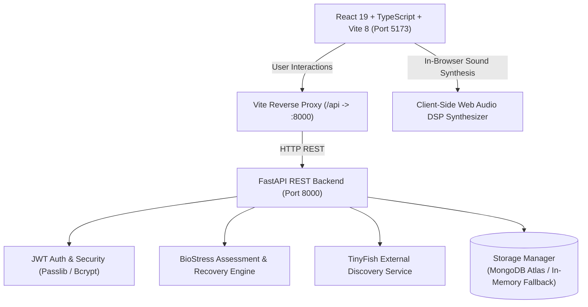

# Psygma • AI Stress Intelligence & Somatic Wellness Platform

> **Engineered by Team OmeGamma**  
> *A grounded, privacy-first BioStress intelligence engine and closed-loop somatic wellness sanctuary designed to detect cognitive fatigue, restore nervous system equilibrium, and guide evidence-based mental recovery.*

---

## 🌟 Table of Contents
1. [Overview & Core Value Proposition](#-overview--core-value-proposition)
2. [Key Capabilities & Features](#-key-capabilities--features)
3. [System Architecture](#-system-architecture)
4. [Tech Stack & Dependencies](#-tech-stack--dependencies)
5. [Prerequisites & Environment Configuration](#-prerequisites--environment-configuration)
6. [How to Run Locally (Step-by-Step)](#-how-to-run-locally-step-by-step)
7. [Pre-Seeded Demo Account](#-pre-seeded-demo-account)
8. [Comprehensive Page & Route Map](#-comprehensive-page--route-map)
9. [REST API Documentation](#-rest-api-documentation)
10. [Automated Test Suite](#-automated-test-suite)
11. [Project Directory Structure](#-project-directory-structure)
12. [Clinical Safety & Ethics Statement](#-clinical-safety--ethics-statement)

---

## 🧠 Overview & Core Value Proposition

Modern professionals face chronic cognitive overload, prolonged screen convergence, disrupted circadian rhythms, and elevated sympathetic nervous activation. Most existing wellness apps rely on superficial questionnaires or isolated meditation timers without contextual grounding.

**Psygma** bridges this gap through an end-to-end **BioStress Intelligence Engine**:
- **Multi-Factor Stress Modeling**: Synthesizes self-reported emotional states, sleep duration and quality, daily cognitive workload, and contextual tags to calculate an acute **Stress Score (0–100)** and estimated autonomic balance.
- **Closed-Loop Adaptive Interventions**: Recovery activities are matched to your exact constraints (available minutes, energy level, indoor vs. outdoor setting, and budget). User feedback directly reinforces or down-weights future suggestions.
- **Client-Side Somatic Sound Synthesizer**: Pure Web Audio API digital signal processing generates therapeutic soundscapes (432 Hz Himalayan bowls, brownian sleep noise, binaural ocean waves, monsoon rain, and traditional Indian classical Bansuri ragas) with **zero external streaming dependencies**.
- **Clinical Vital Safety Boundary System**: Monitors physiological measurements (Blood Pressure, Heart Rate, SpO2, Temperature) with automated medical crisis thresholds (e.g., hypertensive crisis alerts or hypoxemia detection).
- **Biophilic Nature Sanctuary Discovery**: Direct integration with **TinyFish Sanctuary API** (with verified offline curated fallbacks) connecting urban dwellers to high-serenity nature retreats across India (Western Ghats, Himalayan foothills, Coorg, Gokarna).

---

## 🚀 Key Capabilities & Features

### 1. BioStress Assessment & Baseline Calibrator
- Continuous stress tracking calculating **Current Acute Score (0–100)**, **7-Day Rolling Baseline**, and **HRV Proxy (ms)**.
- Analyzes sleep debt, cognitive workload hours, and autonomic stress elasticity.
- Calculates data sufficiency tiers: *Preliminary (<3 check-ins)*, *Calibrating (3–6 check-ins)*, and *Calibrated Baseline (7+ check-ins)*.

### 2. Proactive AI Insights with Rule-Based Grounding
- Autonomous synthesis of cognitive exhaustion warnings when acute patterns emerge (e.g., `< 6.0h sleep` combined with `> 8.0h workload`).
- Provides clear transparent grounding: identifies exact log dates, contributors, potential limitations, and immediate somatic micro-actions.
- Interactive user feedback loop (👍 / 👎) to tune recommendation confidence.

### 3. Context-Aware Recovery Planner
- Generates custom, phased micro-interventions tailored to real-time parameters:
  - **Time Budget**: 5 min, 15 min, 30 min, 45 min, or 60+ min.
  - **Energy State**: Low (restorative somatic), Moderate (active release), High (kinetic balance).
  - **Setting**: Indoor workspace, outdoor nature, quiet sanctuary, any.
  - **Budget**: Free, budget-friendly, retreat.
  - **Social Preference**: Solo solitude, balanced mix, or group connection.
- Step-by-step guidance with live timers and post-exercise reflection logging.

### 4. Somatic Wellness Studio & Web Audio DSP Synthesizer
- **Native Web Audio Oscillators & Noise Buffers**: Instant, ultra-low-latency sound generation running entirely in the user's browser.
- Curated sound therapy categories:
  - **432 Hz Om Chanting & Tanpura Resonance** (amygdala down-regulation)
  - **Evening Bansuri in Raga Yaman** (parasympathetic activation)
  - **Dawn Renewal in Raga Ahir Bhairav** (morning focus and pranayama)
  - **Western Ghats Monsoon Rain** (sensory overload relief)
  - **Himalayan Bronze Singing Bowls** (somatic chest & neck tension release)
  - **Brownian Deep Rest Frequency** (masking intrusive racing thoughts)
- **Interactive 4-4-4-4 Box Breathing Visualizer**: Animated circular somatic pacer with synchronized Inhale (4s) → Hold (4s) → Exhale (4s) → Hold (4s) cycles.

### 5. Vital Health Records & Clinical Safety Guidance
- Validates and logs vital biometric readings:
  - **Blood Pressure** (Systolic & Diastolic mmHg)
  - **Heart Rate** (Resting bpm)
  - **Oxygen Saturation** (SpO2 %)
  - **Body Temperature** (°C / °F)
  - **Sleep Duration** (Hours)
  - **Physical Activity** (Steps / Active Minutes)
  - **Body Weight** (kg / lbs)
- **Safety Boundary Alerts**:
  - 🚨 *Hypertensive Crisis*: Systolic ≥ 180 or Diastolic ≥ 120 mmHg triggers an immediate emergency medical alert banner with explicit instructions not to substitute meditation for medical care.
  - 🚨 *Hypoxemia Alert*: SpO2 < 90% prompts immediate clinical evaluation.
  - 🚨 *Cardiac Alert*: Resting heart rate > 140 bpm or < 40 bpm flags tachycardia/bradycardia advisory.
  - 🚨 *High Fever Alert*: Core temperature ≥ 39.5°C (103.1°F).

### 6. Nature Sanctuaries & TinyFish Travel Discovery
- Biophilic travel intelligence recommending restorative nature sanctuaries:
  - Dense evergreen forests (Wayanad, Dehradun, Coorg)
  - Coastal cliffside havens (Gokarna, Varkala)
  - Highland valley eco-farms (Bengaluru Outskirts, Nilgiris)
- Multi-city distance and travel duration engine (Bengaluru, Delhi, Mumbai, Chennai, etc.).
- Serenity Index (0–100), mindful amenities (silent dining, forest trails, Ayurvedic consultations), and live weather summaries.
- Real-time TinyFish API connectivity with seamless offline curated fallback.

### 7. Executive Wellness & Longitudinal Progress Reports
- Aggregated 7-day (Weekly) and 30-day (Monthly) clinical-grade wellness summaries.
- Stress trends (*Improving*, *Elevating*, *Stable*), check-in completion rates, top recovery triggers, biometric averages, and printable report export.

### 8. Dual-Mode Database Architecture (Atlas + In-Memory Fallback)
- Connects directly to **MongoDB Atlas** for persistent multi-user production data.
- Automatically falls back to an **isolated in-memory storage manager** if MongoDB is unreachable or unconfigured—allowing complete offline evaluation with seeded demo records.

---

## 🏗️ System Architecture



---

## 💻 Tech Stack & Dependencies

### Frontend
- **Framework**: [React 19](https://react.dev/) with [TypeScript 6](https://www.typescriptlang.org/)
- **Build Tool**: [Vite 8](https://vitejs.dev/) (with `@vitejs/plugin-react` and lightning-fast HMR)
- **Routing**: [React Router v7](https://reactrouter.com/) (Public layout, Protected App layout, Route guards)
- **Styling**: [Tailwind CSS v4](https://tailwindcss.com/) with PostCSS & Autoprefixer
- **UI Components & Icons**: [Lucide React](https://lucide.dev/)
- **Animations**: [Framer Motion](https://www.framer.com/motion/) (smooth tab transitions, modal entrances, somatic breathing ring)
- **Data Visualization**: [Recharts](https://recharts.org/) (Stress trends, biometric timelines, sleep-stress correlation)
- **Sound Synthesis**: Native Web Audio API (`AudioContext`, `BiquadFilterNode`, `GainNode`, dynamic pink/brownian noise buffers)

### Backend
- **Framework**: [FastAPI](https://fastapi.tiangolo.com/) (Async ASGI Python 3.11+)
- **Server**: [Uvicorn](https://www.uvicorn.org/) (High-performance ASGI server with auto-reload)
- **Data Validation & Schemas**: [Pydantic v2](https://docs.pydantic.dev/)
- **Authentication**: JWT (JSON Web Tokens via `python-jose` / `pyjwt`) and password hashing via `passlib[bcrypt]`
- **Database Driver**: [PyMongo 4](https://pymongo.readthedocs.io/) (with RFC 3986 credential sanitization and automatic indexing)
- **HTTP Client**: [HTTPX](https://www.python-httpx.org/) (async requests to external wellness APIs)
- **Test Suite**: [Pytest](https://pytest.org/) & `fastapi.testclient` (10/10 test pass coverage)

---

## ⚙️ Prerequisites & Environment Configuration

### Prerequisites
- **Node.js**: Version `18.0.0` or higher (verified on Node `v24.21.0`)
- **Python**: Version `3.10` or higher (verified on Python `3.11.9`)
- **npm**: Version `9.0.0` or higher (bundled with Node)

### Environment Configuration (`.env`)
The project includes a pre-configured `.env` file at the root directory. You can also customize your environment using the template below:

```bash
# ==============================================================================
# PSYGMA APPLICATION ENVIRONMENT CONFIGURATION
# ==============================================================================

# Backend Service Binding
PORT=8000
HOST=127.0.0.1
NODE_ENV=development

# Database (MongoDB Atlas or Local MongoDB)
# Note: If omitted or unreachable, Psygma automatically runs in in-memory mode.
MONGO_URI=mongodb+srv://<username>:<password>@cluster.mongodb.net/omegamma?retryWrites=true&w=majority
MONGO_DB_NAME=psygma_wellness

# Authentication (JWT)
JWT_SECRET=psygma_production_secure_jwt_secret_key_2026_omegamma_wellness_ai_64char
ACCESS_TOKEN_EXPIRE_MINUTES=1440

# TinyFish External Sanctuary Discovery API
# Optional: Curated verified inventory is used if API key is not supplied.
TINYFISH_API_KEY=sk-tinyfish-tr46oB2mKmP0zivtCgNXXCvPX3BGSvAA
TINYFISH_BASE_URL=https://api.tinyfish.wellness/v1

# Frontend Vite Configuration
# Keep empty during local dev to use the Vite proxy (/api -> http://127.0.0.1:8000)
VITE_API_BASE_URL=
VITE_APP_NAME="Psygma • AI Stress Intelligence"
VITE_TINYFISH_SANCTUARY_ENABLED=true
```

---

## 🏃 How to Run Locally (Step-by-Step)

### Option 1: Running in Two Terminal Windows (Recommended)

#### Terminal 1 — Start the Backend Server (FastAPI)
```bash
# Navigate to the project root
cd "d:/Hackathon Projects/Psygma"

# Run the FastAPI ASGI server with auto-reload
python -m uvicorn backend.main:app --host 127.0.0.1 --port 8000 --reload
```
*The backend API will start at: **`http://127.0.0.1:8000`***  
*Interactive Swagger Documentation: **`http://127.0.0.1:8000/docs`***  
*Alternative ReDoc: **`http://127.0.0.1:8000/redoc`***

#### Terminal 2 — Start the Frontend Development Server (Vite)
```bash
# In another terminal window from the project root
cd "d:/Hackathon Projects/Psygma"

# Install frontend dependencies if running for the first time
npm install

# Launch Vite development server
npm run dev
```
*The frontend application will start at: **`http://localhost:5173`***

---

### Option 2: Using NPM Scripts

Psygma includes integrated npm scripts inside `package.json`:

```bash
# Start backend server
npm run backend

# Start Vite frontend in another shell
npm run dev

# Build production bundle
npm run build

# Run linter
npm run lint
```

---

## 👤 Pre-Seeded Demo Account

Psygma comes with an instant evaluation account pre-loaded with **7 days of calibrated check-in data, AI insights, and vital measurements**:

### ⚡ 1-Click Instant Access
1. Open **`http://localhost:5173/login`** in your browser.
2. Click the green **"Instant Demo Access"** button.
3. You will immediately be authenticated and routed directly into the full dashboard!

### 🔑 Manual Login Credentials
| Field | Value |
| :--- | :--- |
| **Email** | `sameer@omegamma.wellness` |
| **Password** | `demo123` |
| **User ID** | `usr_omega_01` |
| **Pre-Seeded Records** | 7 Check-ins, 3 AI Insights, 2 Vital Measurements, 2 Favorite Soundscapes |

*You can also create a completely new, isolated account at **`/signup`** to test onboarding and fresh baseline calibration.*

---

## 🗺️ Comprehensive Page & Route Map

### 🌐 Public Pages
| Route | Component | Purpose |
| :--- | :--- | :--- |
| `/` | `Home.tsx` | Hero banner, interactive stress dial demo, core features showcase, and architecture breakdown. |
| `/how-it-works` | `HowItWorks.tsx` | Methodological breakdown of multi-variable stress estimation, sleep debt, and HRV proxies. |
| `/intelligence` | `Intelligence.tsx` | Algorithmic deep-dive into the BioStress Engine, predictive modeling, and data sufficiency rules. |
| `/wellness` | `WellnessStudio.tsx` | Public preview of somatic audio therapies and the 4-4-4-4 Box Breathing pacer. |
| `/recovery-planner`| `RecoveryPlanner.tsx`| Interactive simulator demonstrating how time, energy, and setting parameters shape recovery. |
| `/travel` | `Travel.tsx` | Indian nature sanctuaries explorer with serenity scores, biomes, and weather snapshots. |
| `/about` | `About.tsx` | Mission statement of Team OmeGamma, clinical advisory background, and core values. |
| `/privacy` | `Privacy.tsx` | Transparent data practices: local-first storage, encryption, and zero third-party brokering. |
| `/contact` | `Contact.tsx` | Inquiries, clinical partnership contacts, and developer issue submission. |

### 🔐 Authentication Pages
| Route | Component | Purpose |
| :--- | :--- | :--- |
| `/login` | `Login.tsx` | Secure email/password login, remember me, and 1-click Demo Login. |
| `/signup` | `Signup.tsx` | Account registration with live password strength validation. |
| `/forgot-password`| `ForgotPassword.tsx`| Password recovery request flow. |
| `/verify-email` | `VerifyEmail.tsx` | Security verification notification view. |
| `/onboarding` | `Onboarding.tsx` | 4-step personalization wizard (sleep goals, somatic interests, work schedule, theme). |

### 🛡️ Protected App Pages (`/app/*`)
*All protected routes require an active JWT session managed via `AuthContext`.*
| Route | Component | Purpose |
| :--- | :--- | :--- |
| `/app` | `Dashboard.tsx` | Central nerve center: acute stress meter, rolling 7-day sparkline, active recovery plan, sound player. |
| `/app/check-in` | `CheckInPage.tsx` | Daily check-in logging (mood, stress 1–10, sleep duration, sleep quality, workload hours, context tags, notes). |
| `/app/stress-monitor`| `StressMonitor.tsx`| Deep physiological stress analytics, HRV proxy gauge, and sleep-vs-stress contributor breakdown. |
| `/app/insights` | `InsightsPage.tsx` | Proactive AI alerts, observation grounding, potential contributors, and feedback (👍/👎) actions. |
| `/app/wellness` | `WellnessPage.tsx` | Full Somatic Wellness Studio with Web Audio Synthesizer, audio sound mixer, and Box Breathing widget. |
| `/app/recovery-planner`| `PlannerPage.tsx`| Context-aware plan generator matching user's exact minutes and energy state with activity completion logging. |
| `/app/travel` | `TravelPage.tsx` | Biophilic sanctuary discovery with origin city distance calculations (Bengaluru, Delhi, etc.) and TinyFish integration. |
| `/app/progress` | `ProgressPage.tsx` | Longitudinal recovery trends, habit consistency streaks, and activity completion milestones. |
| `/app/reports` | `ReportsPage.tsx` | Comprehensive Weekly/Monthly clinical summaries with biometric aggregates and printable report exporter. |
| `/app/health` | `HealthMeasurementsPage.tsx`| Vitals recording (BP, HR, SpO2, Temp, Sleep, Weight) with instant clinical safety boundaries and alerts. |
| `/app/profile` | `ProfilePage.tsx` | User profile, wellness targets, preferred session duration, and interest management. |
| `/app/settings` | `SettingsPage.tsx` | App preferences, privacy toggles, notification options, and account security. |

---

## 📡 REST API Documentation

The FastAPI backend exposes clean, fully typed endpoints grouped by functional domain:

### System & Health
- `GET /api/health` — System status, database connection state, and TinyFish API readiness.

### Authentication & Sessions
- `POST /api/auth/register` — Register a new user with password hashing; returns JWT token and profile.
- `POST /api/auth/login` — Authenticate user credentials; returns JWT token.
- `POST /api/auth/demo-login` — Instant 1-click evaluation access with pre-seeded demo history.
- `POST /api/auth/logout` — Revoke and blacklist the active JWT token.
- `GET /api/auth/me` — Retrieve the current authenticated user profile.

### Daily Check-Ins & Assessment
- `GET /api/checkins` — Retrieve the user's chronological check-in history.
- `POST /api/checkins` — Record a new check-in; triggers real-time stress assessment and proactive AI alerts.
- `GET /api/assessment` — Compute acute stress score, baseline comparison, and contributor breakdown.

### AI Insights & Feedback
- `GET /api/insights` — Fetch proactive AI insights and pattern observations.
- `POST /api/insights/{id}/feedback` — Submit user feedback (`helpful` / `not_helpful`) to refine recommendations.

### Somatic Activities & Closed-Loop Reinforcement
- `GET /api/activities` — Retrieve completed activity log with user ratings and duration.
- `POST /api/activities` — Log completion of a somatic recovery exercise (reinforces user interests if rated helpful).

### Therapeutic Audio & Music
- `GET /api/music/tracks` — Curated list of Indian classical ragas, Om chanting, and natural soundscapes with user favorite indicators.
- `POST /api/music/favorite` — Toggle favorite status for a track.
- `POST /api/music/feedback` — Submit post-listening somatic effectiveness ratings.

### Vital Health Measurements & Safety
- `GET /api/health-measurements` — Retrieve physiological history (BP, HR, SpO2, etc.).
- `POST /api/health-measurements` — Validate ranges and record a new vital measurement; triggers safety alerts if values breach clinical thresholds.
- `DELETE /api/health-measurements/{id}` — Remove a logged health record.

### Nature Sanctuaries & Travel
- `GET /api/travel/retreats` — Query nature retreats filtered by biome, origin city, region, or budget.

### Reports & Recovery Plans
- `GET /api/reports/summary?period=weekly|monthly` — Generate an executive wellness report summarizing stress trends and vitals.
- `POST /api/recovery-plan` — Generate a tailored micro-recovery action plan matching real-time user constraints.
- `GET /api/user/profile` & `PATCH /api/user/profile` — Read and update user wellness goals and preferences.

---

## 🧪 Automated Test Suite

Psygma includes an automated end-to-end Python test suite verifying health checks, authentication, data isolation, token revocation, biometric validations, and AI plan generation:

```bash
# Run the test suite from the project root
python -m pytest tests/test_backend.py -v
```

### Test Coverage Highlights
```
tests/test_backend.py::test_health_check PASSED                          [ 10%]
tests/test_backend.py::test_unauthenticated_protected_routes PASSED      [ 20%]
tests/test_backend.py::test_demo_login_and_data_isolation PASSED         [ 30%]
tests/test_backend.py::test_token_revocation_on_logout PASSED            [ 40%]
tests/test_backend.py::test_preference_filtering_in_recommendations PASSED [ 50%]
tests/test_backend.py::test_activity_completion_and_reflection PASSED    [ 60%]
tests/test_backend.py::test_health_measurements_crud_and_safety_alerts PASSED [ 70%]
tests/test_backend.py::test_music_tracks_and_feedback PASSED             [ 80%]
tests/test_backend.py::test_indian_travel_retreats_and_city_filter PASSED [ 90%]
tests/test_backend.py::test_reports_summary_generation PASSED            [100%]

======================== 10 passed in 7.10s ========================
```

---

## 📁 Project Directory Structure

```
psygma/
├── .env                         # Active environment configuration
├── .env.example                 # Comprehensive template with documentation
├── package.json                 # Frontend dependencies & npm run scripts
├── vite.config.ts               # Vite server config & /api reverse proxy
├── tsconfig.json                # TypeScript project configuration
├── tailwind.config.js           # Tailwind CSS styling tokens
│
├── backend/                     # Python FastAPI Backend
│   ├── main.py                  # API routes, middleware & app lifecycle
│   ├── auth.py                  # JWT creation, token decoding & bcrypt hashing
│   ├── models.py                # Pydantic data schemas & request models
│   ├── database.py              # MongoDB driver with graceful in-memory fallback
│   └── services/
│       ├── stress_ai.py         # BioStress calculation engine & recovery planner
│       └── tinyfish.py          # TinyFish external sanctuary discovery service
│
├── src/                         # React Frontend (TypeScript)
│   ├── App.tsx                  # Top-level routing, layouts & ProtectedRoute
│   ├── main.tsx                 # React DOM mount
│   ├── index.css                # Global stylesheet & design tokens
│   │
│   ├── context/                 # State Providers
│   │   ├── AuthContext.tsx      # JWT session management & user state
│   │   └── WellnessContext.tsx  # Assessment state & quick action triggers
│   │
│   ├── services/
│   │   ├── api.ts               # Typed client calling backend REST endpoints
│   │   └── audioSynth.ts        # Pure Web Audio DSP sound synthesizer
│   │
│   ├── components/
│   │   ├── layout/              # AppLayout, PublicLayout, Layout
│   │   ├── navigation/          # Navbar, Footer
│   │   └── wellness/            # BreathingWidget, AudioPlayer, StressChart, ReflectionModal
│   │
│   └── pages/
│       ├── public/              # Home, HowItWorks, Intelligence, Travel, About, etc.
│       ├── auth/                # Login, Signup, Onboarding, ForgotPassword, VerifyEmail
│       └── app/                 # Dashboard, CheckInPage, StressMonitor, InsightsPage,
│                                # WellnessPage, PlannerPage, TravelPage, ReportsPage,
│                                # HealthMeasurementsPage, ProfilePage, SettingsPage
│
└── tests/
    └── test_backend.py          # Pytest suite testing API routes & AI algorithms
```

---

## 🩺 Clinical Safety & Ethics Statement

1. **Non-Diagnostic Nature**: Psygma is designed for somatic stress reduction, cognitive restoration, and wellness optimization. It does not diagnose, treat, or replace professional clinical care for major depressive disorder, generalized anxiety disorders, or acute cardiac/metabolic conditions.
2. **Clinical Safety Safeguards**: The platform embeds non-negotiable safety rules. If physiological measurements indicate potentially dangerous anomalies (such as a hypertensive crisis $\ge 180/120\text{ mmHg}$ or SpO2 $< 90\%$), Psygma directs the user to seek emergency medical attention and disallows relying on somatic exercises in place of emergency care.
3. **Data Privacy First**: User wellness reflections and biometric values are strictly protected under authenticated user IDs, never monetized, and never sold to third-party data brokers.

---

<div align="center">
  <b>Psygma • Powered by Team OmeGamma</b><br/>
  <i>Bridging autonomic intelligence with modern human restoration.</i>
</div>
